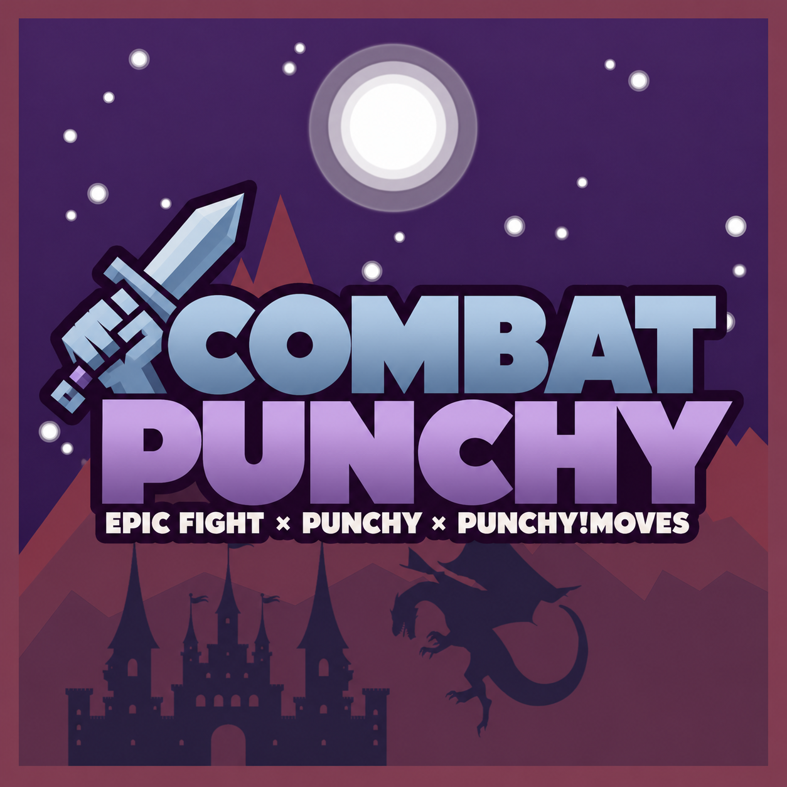

**Combat Punchy**

- [Home](https://github.com/Mikaaah/Combat-Punchy/wiki/Home)
- [Automatic combat](https://github.com/Mikaaah/Combat-Punchy/wiki/Automatic-Combat)
- [Animation compatibility](https://github.com/Mikaaah/Combat-Punchy/wiki/Animation-Compatibility)
- [Weapon support](https://github.com/Mikaaah/Combat-Punchy/wiki/Weapon-Support)
- [Configuration](https://github.com/Mikaaah/Combat-Punchy/wiki/Configuration)
- [Compatibility](https://github.com/Mikaaah/Combat-Punchy/wiki/Compatibility)
- [Known issues](https://github.com/Mikaaah/Combat-Punchy/wiki/Known-Issues)

[Changelog](https://github.com/Mikaaah/Combat-Punchy/blob/main/CHANGELOG.md) · [Issues](https://github.com/Mikaaah/Combat-Punchy/issues)

### Community

- [All mod projects](https://mikaaah.github.io/TownsAndKingdoms/projects/)
- [Join Discord](https://discord.gg/CRYk3uDPVt)
- [Report an issue](https://github.com/Mikaaah/Combat-Punchy/issues)

### Edition guides

- [1.2 · Forge 1.20.1](https://github.com/Mikaaah/Combat-Punchy/tree/port/forge-1.20.1)
